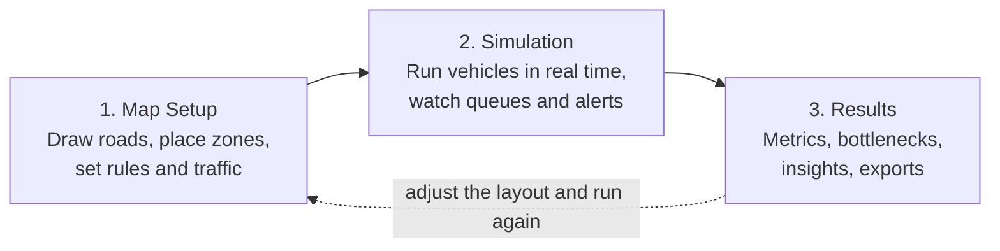

<div align="center">

# FlowSmart

### Campus Traffic Flow Simulator

**A browser-based, top-down traffic simulator for modeling vehicle flow, queues, and drop-off bottlenecks on a school campus.**


-2E7D32?style=flat-square)

**Don Bosco Technical College, Mandaluyong** &nbsp;|&nbsp; Grade 12 Research Thesis &nbsp;|&nbsp; S.Y. 2026-2027

</div>

---

## Table of Contents

1. [Overview](#overview)
2. [Alignment with SDG 11](#alignment-with-sdg-11)
3. [Key Features](#key-features)
4. [How It Works](#how-it-works)
5. [Simulation Model](#simulation-model)
6. [Metrics Explained](#metrics-explained)
7. [Automated Insights](#automated-insights)
8. [Default Settings Reference](#default-settings-reference)
9. [Getting Started](#getting-started)
10. [Project Structure](#project-structure)
11. [Data, Privacy and Reproducibility](#data-privacy-and-reproducibility)
12. [Verification](#verification)
13. [Limitations](#limitations)
14. [Research Team](#research-team)

---

## Overview

School campuses are small road networks with a very uneven load. Hundreds of vehicles arrive within a narrow morning window, most of them need to stop at a drop-off zone, and the road space available for queuing is limited. When the queue outgrows the road, it spills into the surrounding streets.

**FlowSmart** lets a school administrator, student, or researcher:

- **Draw** the campus road network on a blank grid or over a photo or floor plan of the real campus.
- **Configure** entrances, exits, drop-off zones, lane counts, one-way rules, sticker-only and non-sticker-only roads, arrival rates, and driver behavior.
- **Simulate** the morning rush with individually modeled vehicles that accelerate, follow one another, yield at merges, stop to drop off students, and leave.
- **Measure** the outcome with throughput, wait time, transit time, queue length, and flow efficiency.
- **Compare** layouts by running them repeatedly and exporting the results as a PDF report or CSV run log.

The goal is to let a campus test a road or drop-off redesign on a screen before changing anything on the ground.

> [!NOTE]
> FlowSmart is a **thesis prototype**. It is a planning aid for comparing layouts, not a certified traffic engineering tool. See [Limitations](#limitations).

---

## Alignment with SDG 11

FlowSmart is themed around **United Nations Sustainable Development Goal 11: Sustainable Cities and Communities**, which aims to make cities and human settlements inclusive, safe, resilient, and sustainable. A school campus and its surrounding streets are a small-scale version of that urban problem.

| SDG 11 Target | Relevance to FlowSmart |
|---|---|
| **11.2** Safe, affordable, accessible, and sustainable transport systems | Helps campuses design circulation that moves vehicles efficiently and keeps queues from spilling onto public roads, where they obstruct traffic and endanger pedestrians. |
| **11.3** Inclusive and sustainable urbanization and participatory planning | Gives non-specialists a visual, interactive way to take part in planning discussions about campus access and circulation. |
| **11.6** Reduce the adverse environmental impact of cities, including air quality | Shorter queues and shorter waits mean less time spent idling. FlowSmart reports waiting time directly, which is the quantity that idling emissions depend on. It does **not** compute emissions itself. |

---

## Key Features

| Area | What it does |
|---|---|
| **Map setup** | Draw roads as polylines, split roads to make intersections, and place Entrance, Exit, and Drop-off markers. Roads snap to existing road ends. |
| **Reference image overlay** | Attach a PNG or JPG (200 KB to 5 MB) of the real campus and trace over it. The image is a visual guide only and is never saved or exported. |
| **Scale calibration** | Click two points on the image and enter the real distance, or choose a grid scale. Every length, speed, gap, and capacity is derived from this scale. |
| **Road rules** | Per road: one-way or two-way (with reverse), number of lanes, and access type (Shared, Sticker-only, Non-sticker-only). |
| **Traffic controls** | Per-entrance arrival rate, sticker share, speed limit, drop-off share, driver patience, drop-off dwell time, vehicle length, and standstill gap. |
| **Live simulation** | Real-time canvas with zoom, pan, pause, stop, and adjustable speed (0.5x to 5x). Optional congestion heatmap. |
| **Live alerts** | Configurable warnings when a road stays saturated or vehicles wait too long, which clear automatically on recovery. |
| **Results dashboard** | Five headline metrics with color-coded ratings, drop-off statistics, ranked bottlenecks, and generated recommendations. |
| **Run log and exports** | Every finished run is logged. Export a landscape PDF report, a CSV run log, or the full scenario as JSON. |
| **Built-in help** | Each of the three screens has a plain-language guide inside the app. |
| **Edge-case handling** | Detects and explains maps with no entrance, no exit, no valid path, zero arrivals, blocked exits, and gridlock. |

---

## How It Works

FlowSmart is organized as a three-stage workflow, matching the three tabs in the application.



### Stage 1: Map Setup

The user builds the campus. Roads are stored as ordered lists of points. A two-way road becomes two directed edges, and a one-way road becomes a single edge that follows the order in which it was drawn. Zone markers are attached to the nearest road node.

A map must have **at least one entrance and one exit connected by roads** before it can run. If it does not, the Simulation screen explains exactly what is missing.

### Stage 2: Simulation

Each run starts from a **seed** (a number that fixes the sequence of random choices). Vehicles are created at entrances, assigned a route, and then driven forward in small time steps until the run ends. The engine is a pure TypeScript module with no React or DOM dependencies, so the same code runs in the browser and in the automated test harness.

### Stage 3: Results

When the run completes, the engine produces a result object. The Results screen turns it into metric cards, a bottleneck ranking, and recommendations. The run is appended to the run log together with the seed, the arrival rates, and the sticker share that produced it.

---

## Simulation Model

### Time and randomness

| Property | Value |
|---|---|
| Time step | Fixed **0.1 s** of simulated time per step |
| Playback speed | 0.5x to 5x (up to 30 physics steps per rendered frame) |
| Run length | Configurable, default **30 min** |
| Grace period | Up to **10 extra minutes** after arrivals stop so vehicles already inside can clear |
| Random generator | **Mulberry32**, seeded per run; the seed is saved with the result |
| Rendering | Positions are interpolated between steps for smooth motion |

### Vehicle arrivals

Vehicles arrive at each entrance as a **Poisson process**: the gap between consecutive arrivals is drawn from an exponential distribution whose mean is `60 / rate` seconds. This reproduces the natural clustering of real traffic, where cars sometimes arrive in bunches and sometimes in gaps, rather than at perfectly even intervals.

At arrival, each vehicle is randomly given:

- **Sticker or non-sticker status**, according to the configured sticker share (default 70% sticker).
- **A drop-off requirement**, according to the configured drop-off share (default 100%).

If the first stretch of road at the entrance does not have enough free space for a new vehicle (less than the standstill gap), the arrival is skipped and counted as a **blocked spawn**. If no legal route exists for that vehicle, it is counted as an **unroutable spawn**.

### Routing: drawn-path following

FlowSmart does **not** use shortest-path routing (Dijkstra or A*). Instead, vehicles follow the roads the user actually drew:

1. For each entrance, the router enumerates **loop-free paths** from the entrance to a drop-off and from the drop-off to an exit (or directly to an exit for vehicles that do not drop off). A path may not revisit a node, except that the drop-off node joins the two legs.
2. Paths are filtered by **access rules**. A sticker-only road is excluded from non-sticker routes, and a non-sticker-only road is excluded from sticker routes. A vehicle class never falls back to routes of the other class.
3. Each entrance keeps at most **200 routes** per vehicle class (the ones with the fewest road segments).
4. Each new vehicle is assigned **one route chosen uniformly at random** from its eligible pool.

This spreads traffic across every legal path on the map, which is what lets the simulation reveal which roads become overloaded.

### Car following

Vehicles use an **Intelligent Driver Model (IDM)** style controller:

| Parameter | Value | Meaning |
|---|---|---|
| Desired speed | Road speed limit (5, 10, or 15 km/h) | Target free-flow speed |
| Acceleration `a` | 1.5 m/s² | Maximum comfortable acceleration |
| Deceleration `b` | 2.0 m/s² | Comfortable braking |
| Time headway `T` | 1.2 s | Preferred time gap to the vehicle ahead |
| Standstill gap `s0` | 2.0 m (configurable) | Minimum bumper-to-bumper gap when stopped |
| Vehicle length | 4.5 m (configurable) | Used for spacing and for rendering |

Each vehicle looks up to **80 m** ahead along its own route to find a leader, including across road boundaries. A hard overlap guard guarantees no vehicle ever passes through or closer than the standstill gap to the one in front. There is no overtaking.

### Merging

When two roads feed into the same next road, vehicles within **25 m** of the junction check whether another approach has priority:

- A road with **more lanes** (or one marked as a main road) has priority over a smaller one.
- On equal roads, the vehicle **closer to the junction** goes first, and ties are broken by who entered the campus earlier (first come, first served).

A yielding vehicle brakes smoothly to a stop short of the junction instead of entering it.

### Drop-off behavior

The drop-off zone is the most important part of the model, because it is usually where campus queues begin.

1. A vehicle that needs a drop-off brakes toward a stop line so that its **center** sits on the drop-off marker.
2. It then **dwells** for a random duration, **uniformly distributed between 20 and 60 seconds** by default.
3. The zone holds at most **2 vehicles at once**. Others queue behind. Only the single slot right behind the marker may begin its dwell while queued behind a dwelling vehicle.
4. **Patience:** if a vehicle is held near the zone (within 40 m, nearly stopped) for longer than its patience, it gives up and **drops off where it is**. Patience is `30 s` plus a random `0 to 20 s`, so drivers do not all give up at the same moment. These are recorded as **early drop-offs**.
5. After the dwell, the vehicle continues to its exit.

### Segment capacity and congestion

Each road segment has a **storage capacity**, the number of vehicles it can hold when queued:

```
capacity = round( road length / (vehicle length + standstill gap) x lanes )
```

With the defaults, every vehicle occupies **6.5 m** of road per lane. Utilization is simply the number of vehicles currently on the segment divided by this capacity.

### Gridlock detection

If vehicles are on campus but **none has moved faster than 0.5 m/s for 120 consecutive simulated seconds**, the run is stopped and flagged as gridlocked, and the result carries an explanatory message.

---

## Metrics Explained

> [!IMPORTANT]
> All headline metrics count **only vehicles that completed their trip** (reached an exit). Vehicles still on campus when the run ends are reported separately as unfinished, not folded into the averages.

### The five headline metrics

Each metric appears as a card with a color-coded badge: green (good), amber (needs attention), red (critical).

| Metric | What it measures | How it is computed | Good | Warning | Critical |
|---|---|---|---|---|---|
| **Total throughput** | How many vehicles the campus moved through per hour (higher is better) | `exited vehicles / run duration in hours` | 1,200+ veh/hr | 900 to 1,199 | under 900 |
| **Average wait time** | How long a typical vehicle spent stopped or crawling (lower is better) | Total seconds spent at under 0.5 m/s, averaged over exited vehicles | under 30 s | 30 to 50 s | over 50 s |
| **Average transit time** | Total time from entering the campus to leaving it (lower is better) | `exit time - enter time`, averaged over exited vehicles | under 150 s | 150 to 180 s | over 180 s |
| **Max queue length** | The longest line of queued vehicles on any single road segment (lower is better) | Peak count of vehicles at under 0.5 m/s on one segment, across the whole run | 5 or fewer | 6 to 14 | 15 or more |
| **Flow efficiency** | How close the campus came to its theoretical capacity (higher is better) | `(throughput / configured max capacity) x 100`, capped at 100% | 75%+ | 60 to 74% | under 60% |

**Worked example.** Suppose 300 vehicles exit during a 30-minute run. Throughput is `300 / 0.5 h = 600 veh/hr`. If the bottleneck on the main route is a single-lane road, the configured maximum capacity is `1 lane x 1,900 = 1,900 veh/hr`, so flow efficiency is `600 / 1,900 = 32%`.

### Configured maximum capacity

This is the theoretical ceiling used as the denominator of flow efficiency. For each entrance, the engine takes the route with the **fewest road segments**, finds the **minimum lane count along it**, and multiplies by **1,900 veh/hr/lane** (a standard saturation-flow figure for one lane). The campus value is the **lowest** such number across all entrances.

### Wait time

A vehicle accumulates wait time whenever it is in the **queued** state: moving slower than 0.5 m/s and not in the middle of its drop-off dwell. Time spent actively unloading students is not counted as queue delay.

### Drop-off statistics

| Statistic | Meaning |
|---|---|
| **Total drop-offs** | Vehicles whose drop-off started during the run. |
| **Early drop-offs** | Of those, vehicles that ran out of patience and dropped off away from the zone. A high count means the drop-off cannot absorb the arrival volume. |
| **Average wait at drop-off** | Mean time vehicles were held up near the zone before their drop-off began. |

### Bottleneck ranking

Every road segment is ranked by its **peak queue length**.

| Severity | Condition (peak queue on that segment) |
|---|---|
| **Clear** | 4 vehicles or fewer |
| **Moderate** | 5 to 12 vehicles |
| **Critical** | more than 12 vehicles |

Each entry also shows the peak queue as a percentage of that segment's storage capacity, which tells you whether a queue is long in absolute terms or simply long relative to a short road.

### Other reported values

| Value | Description |
|---|---|
| **Seed** | The random seed of the run, saved for traceability. |
| **Spawned sticker / non-sticker** | The actual number of each class that entered, which differs slightly from the configured share because each vehicle is drawn at random. |
| **Blocked spawns** | Arrivals skipped because the entrance had no room. A sign of spillback at the gate. |
| **Unroutable spawns** | Arrivals with no legal route. A sign of conflicting one-way or access rules. |
| **Unfinished vehicles** | Vehicles still on campus at the end of the run. |

### Live metrics versus final metrics

While a run is in progress, the Simulation screen shows live approximations. They are intentionally different from the final figures:

| Live value | How it differs from the final result |
|---|---|
| **Throughput** | Based on exits in the **last 5 minutes** multiplied by 12, so it tracks current conditions. The final value is averaged over the whole run. |
| **Average wait** | Includes vehicles **still on campus** as well as completed ones. The final value uses completed trips only. |
| **Road heatmap** | Green under 60% utilization, amber from 60 to 80%, red above 80%. |

### Congestion alerts

Alerts appear during the run and clear on their own. All thresholds are adjustable.

| Setting | Default | Meaning |
|---|---|---|
| Wait threshold | 120 s | Delay that triggers a critical alert |
| Saturation threshold | 80% | Utilization that counts as saturated |
| Duration threshold | 30 s | How long saturation must last before the alert appears |
| Recovery threshold | 60% | Utilization the road must fall back to before the alert clears |

---

## Automated Insights

After each run, FlowSmart generates **at least two** plain-language recommendations from five rules:

| # | Trigger | Recommendation |
|---|---|---|
| 1 | The top bottleneck is the drop-off zone | **Stagger drop-off windows** (peak queue of 8 or fewer), or **add a second loading bay** (peak queue above 8) |
| 2 | One segment is at 80% utilization or higher while another is under 60% | **Reroute flow to the underused road** |
| 3 | A queue at an entrance exceeds 10 vehicles | **Add a lane or a second gate** at that entrance |
| 4 | More than 5 blocked spawns, or any unroutable spawn | **Check one-way and sticker rules** near the entrance |
| 5 | Fewer than two rules apply | Report the top two bottlenecks with their peak queues |

The insights are rule-based and deterministic. The application does not use any external AI service or API.

---

## Default Settings Reference

| Setting | Default | Allowed range |
|---|---|---|
| Simulation length | 30 min | Configurable |
| Speed limit | 10 km/h | 5, 10, or 15 km/h |
| Arrival rate | 18 veh/min (Gate 1), 12 veh/min (Gate 2) | 0 to 120 veh/min per entrance |
| Sticker share | 70% | 0 to 100% |
| Cars that drop off | 100% | 0 to 100% |
| Driver patience | 30 s | 5 to 300 s |
| Patience spread | 20 s | 0 to 120 s |
| Drop-off dwell time | 20 to 60 s | 5 to 300 s |
| Vehicle length | 4.5 m | 1 to 20 m |
| Standstill gap | 2.0 m | 0.5 to 10 m |
| Default map scale | 0.2 m per canvas unit | Calibrated by the user |
| Lane width (drawing) | 3.0 m | Fixed |

The built-in **sample map** is a 14-segment campus with two entrances (Gate 1 main, Gate 2 east), two exits (north and west), and one elementary drop-off loop. It includes shared, sticker-only, and non-sticker-only roads so that every feature can be tried immediately.

---

## Getting Started

### Requirements

- **Node.js 20 or higher**
- A modern desktop browser (a laptop-sized screen or larger is recommended, since the tool is a three-panel workspace)

### Installation

```bash
# 1. Install dependencies
npm install

# 2. Start the development server (http://localhost:3000)
npm run dev
```

### Other commands

| Command | Purpose |
|---|---|
| `npm run dev` | Start the development server on port 3000 |
| `npm run build` | Create a production build in `dist/` |
| `npm run preview` | Serve the production build locally |
| `npm run lint` | Type-check the project with `tsc --noEmit` |

### Deployment

FlowSmart is a static single-page application and deploys to any static host (for example Vercel).

| Setting | Value |
|---|---|
| Framework | Vite |
| Build command | `npm run build` |
| Output directory | `dist` |
| Environment variables | None required |

### Quick tour

1. Open **Map Setup** and choose **Load sample map**, or **Start blank layout** to draw your own.
2. Set the **map scale** before drawing, because all distances depend on it.
3. Draw roads, then place at least one **Entrance** and one **Exit** (and a **Drop-off** zone if vehicles should stop).
4. Adjust traffic settings in the right panel, then choose **Save and go to simulation**.
5. Press **Run simulation**. Turn on the **Heatmap** to see where roads fill up.
6. When the run ends, press **View results**. Change the layout and run again to compare.

> [!TIP]
> Because arrivals are random, two runs of the same layout will differ slightly. Run each layout several times and compare the averages in the run log rather than relying on a single run.

---

## Project Structure

```
FlowSmart/
├── public/                       Static assets (favicon)
├── index.html                    App entry page
├── vite.config.ts                Vite + React + Tailwind configuration
├── package.json                  Scripts and dependencies
└── src/
    ├── App.tsx, main.tsx         Application shell and bootstrap
    ├── types/
    │   └── traffic.ts            Shared data models (roads, zones, settings, results)
    ├── sim/                      Pure simulation engine (no React or DOM)
    │   ├── engine.ts             Time stepping, spawning, car following, merging,
    │   │                         drop-off, gridlock, metrics
    │   ├── graph.ts              Road graph builder and drawn-path router
    │   ├── insights.ts           Rule-based recommendation generator
    │   ├── harness.ts            Console test harness (spacing and access invariants)
    │   ├── types.ts              Engine-level types
    │   └── index.ts              Public API of the engine
    ├── context/
    │   ├── TrafficStoreContext   Map, settings, run log, and LocalStorage persistence
    │   └── SimulationContext     Run lifecycle, fixed-step loop, alerts
    ├── components/
    │   ├── map-setup/            Map editor
    │   ├── canvas/               Live simulation canvas and heatmap
    │   ├── views/                Results dashboard and placeholders
    │   ├── layout/               Top bar, side panels, in-app help content
    │   └── common/               Help modal, error boundary, controls, scale bar
    ├── hooks/
    │   └── useWireTool.ts        Road drawing tool
    └── utils/                    Geometry, scale, image handling, sample map
```

### Technology stack

| Layer | Technology |
|---|---|
| UI | React 19, TypeScript |
| Build tool | Vite 8 |
| Styling | Tailwind CSS 4 |
| Icons and motion | lucide-react, motion |
| Report export | jsPDF, html2canvas |
| Typography | Inter (via Fontsource) |

---

## Data, Privacy and Reproducibility

- **No server and no accounts.** Maps, settings, and the run log are stored in the browser's **LocalStorage**. Nothing is transmitted anywhere.
- **Reference images are never stored or exported.** They exist only for the current browser session, so reattach the image after reloading the page.
- **Portable scenarios.** Use **Export map** to save the full scenario (map and settings) as a JSON file, and import it later or in another browser.
- **Crash recovery.** If the interface hits an unexpected error, an error screen offers **Export map JSON** so work is never lost.
- **Traceable runs.** Every run stores its seed, arrival rates, and sticker share. The CSV run log includes all of these alongside the metrics.

---

## Verification

The engine includes a **console test harness** (`src/sim/harness.ts`) that checks the physical rules of the model automatically.

| Check | What it asserts |
|---|---|
| **No overlap** | Across 5 simulated minutes at a high arrival rate, no vehicle is ever closer to its leader than the standstill gap (with a 0.05 m tolerance). |
| **No large holes** | When both a vehicle and its leader are stopped, the gap does not exceed the standstill gap by more than 1 m. |
| **Scale independence** | The same run is repeated at map scales of **0.05, 0.11, 0.2, 0.45, and 1.0 m per unit** to confirm behavior does not depend on drawing scale. |
| **Access rules** | An entrance whose only road is sticker-only produces only sticker vehicles. Parallel restricted roads are used by the correct classes only. |

Each scale runs **3,000 steps** at the fixed 0.1 s time step, and the harness throws an error if any invariant is violated.

---

## Limitations

FlowSmart is intentionally scoped. These are the main simplifications to keep in mind when interpreting results:

- **Campus scale only.** Speeds are limited to 5, 10, or 15 km/h, reflecting campus roads, and the speed limit is applied map-wide.
- **No traffic lights or pedestrian crossings.** Conflicts are resolved by yielding rules, and pedestrians are not modeled.
- **Passenger cars only.** There is a single vehicle type. Buses, tricycles, and motorcycles are not modeled separately.
- **No overtaking or lane changing.** Each vehicle follows the single route assigned to it.
- **Constant arrival rate.** Arrivals are random but follow a fixed average rate for the whole run, with no built-in rush-hour ramp.
- **Emissions are not computed.** Wait time is reported as a proxy for idling, but fuel use and emissions are not estimated.
- **Not calibrated against field data.** Parameter defaults are sensible starting values, not measurements from a specific campus.

---

## Research Team

**Research Thesis, Grade 12, S.Y. 2026-2027**
Don Bosco Technical College, Mandaluyong

| Member | Role |
|---|---|
| **Ethan Jaiden P. Tamayo** | Group Leader, Lead Software Developer |
| Vince Wramlee O. Del Rosario | Research Group Member |
| John Aron Isaiah Q. Calabia | Research Group Member |
| Eduard Jefferson B. Manalo | Research Group Member |
| Henri Isaiah Q. Samson | Research Group Member |

---

<div align="center">

**FlowSmart** is a thesis prototype for Don Bosco Technical College (DBTC), developed in support of **UN SDG 11: Sustainable Cities and Communities**.

</div>
